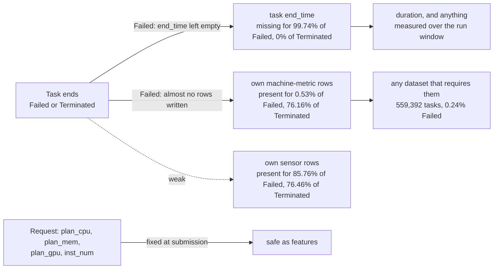

# Label-proxy columns in the Alibaba PAI 2020 GPU trace (cluster-trace-gpu-v2020)

Companion to the report *One User Dominates: An Audit and User-Grouped Re-check of Task-Failure Prediction on the Alibaba PAI GPU Trace (cluster-trace-gpu-v2020)* (Table 2 there). Sajish Krishnan, 17 November 2026.

Some columns in this trace are close to a copy of the task's outcome. A failure predictor that uses them, or a dataset filter that depends on them, will look far better than it is. The KANVAS project's code already says so for the end time and the machine-metric rows (see "Who described this first" below). This file lists the columns with measured coverage, and lists the columns that are fixed before a task runs.

Population: resolved tasks that requested a GPU. That is 985,358 tasks, of which 252,667 are Failed and 732,691 are Terminated. Failed is the positive label. The trace README says only Terminated tasks are successful.

Read it left to right. The outcome decides whether the end time and the machine-metric rows exist, so both carry the label backwards into anything built on them. The request columns at the bottom are set before the task runs and do not. The dotted arrow is a weaker effect of the same kind.

## The table

| # | Column or condition | Failed tasks | Terminated tasks | If used as a single yes/no predictor of failure | Also contaminates |
|---|---|---|---|---|---|
| 1 | Task `end_time` is missing | 252,017 of 252,667 (99.74%) | 0 of 732,691 (0%) | AUC 0.9987 | Duration; any average, maximum or count taken over the task's run window; any filter on duration |
| 2 | The task's first instance has no rows in `pai_machine_metric` | 251,321 of 252,667 (99.47%) | 174,645 of 732,691 (23.84%) | AUC 0.8782 | Every machine-metric value joined on the task's own worker; any dataset that keeps only tasks with such rows |
| 3 | The task's first instance has rows in `pai_sensor_table` | 216,693 of 252,667 (85.76%) | 560,249 of 732,691 (76.46%) | AUC 0.5465 | Sensor values describe the run itself, so they are post-launch whatever their coverage |

Row 2 is the complement of the figure quoted in the paper: the rows are present for 1,346 of 252,667 Failed tasks (0.53%) and 558,046 of 732,691 Terminated tasks (76.16%).

The AUC column is arithmetic on the two rates in the row, not a fitted model. For a yes/no column, AUC = 0.5 + (true-positive rate − false-positive rate) ÷ 2.

## What row 2 does as a filter

| Population | Tasks | Failed | Failed % |
|---|---|---|---|
| Resolved GPU tasks | 985,358 | 252,667 | 25.64 |
| … whose first instance has sensor rows | 776,942 | 216,693 | 27.89 |
| … and machine-metric rows | 559,392 | 1,346 | 0.24 |

A dataset built by joining tasks to their own machine-metric rows keeps 559,392 tasks and loses all but 1,346 of the failures.

## The same pattern in the other tables

| Table | Failed: `end_time` missing | Terminated: `end_time` missing |
|---|---|---|
| `pai_job_table` | 230,935 of 256,555 (90.01%) | 0 of 732,355 |
| `pai_task_table`, all tasks | 255,522 of 256,762 (99.52%) | 0 of 885,073 |
| `pai_instance_table` | 888,444 of 969,975 (91.59%) | 11 of 4,757,371 |

| Instance status | Instances with machine-metric rows |
|---|---|
| Terminated | 42.38% |
| Failed | 0.09% |
| Running | 0.02% |
| Interrupted | 0.01% |

## Columns fixed before the task runs

| Column | Known when | Note |
|---|---|---|
| `plan_cpu`, `plan_mem`, `plan_gpu`, `inst_num` | Submission | The only features the paper's models use |
| `user` (from the job table) | Submission | Use it as a split key. As a feature it lets a model recognise users (paper, Section 4.6) |
| task `start_time` | Launch | Safe for ordering a time split. It has no missing values among resolved GPU tasks |
| `gpu_type` (task table) | Placement | The README defines it as the GPU type *assigned*, so it describes the machine, not the request |
| `pai_machine_spec` columns of the assigned machine | Placement | Static per machine |
| Machine-metric rows of *other* jobs' workers on the same machine before the task starts | Before launch | This is what the KANVAS feature matrix uses. We did not rebuild these features. Requiring them selects tasks, though not on the label in the way row 2 does: the subset's failure rate is 27.40% against 25.64% |

## Who described this first

Not this file. The KANVAS project's code (`kanvas/data.py`, module docstring, read at commit 3c3fa2a) says that machine-metric rows exist almost only for workers that finished normally (42% of Terminated instances against 0.09% of Failed ones, the figures in the instance table above), that 99% of failed tasks' instances never record an end time, and that a join on a task's own worker therefore removes nearly every failure. KANVAS joins telemetry by machine, before the task starts, for that reason. The observation is theirs. What this file adds is the measurement: per-task coverage on every resolved GPU task, the job-table figures, the yes/no AUC arithmetic and the filter table.

## What we did not establish

- **Why the columns behave this way.** The machine-metric table's start and end times are never null, and the README describes them as the instance's own times. Our reading is that metric rows exist only for instances that recorded an end, which Failed instances mostly do not. That is inferred from the tables, not confirmed by the trace's authors.
- **Whether any published model on this trace is affected.** We have not run anyone else's pipeline. Studies that filter jobs by duration or use the first minutes of usage would need to say how tasks without an end time were handled; we make no claim about any of them.
- **Whether anyone described it before KANVAS.** We did not find it in the trace README. We did not search further. An open question on the trace's issue tracker (alibaba/clusterdata issue #198) asks about missing end times.

## Where each number comes from

| Numbers | Output file | Field |
|---|---|---|
| Row 1; the job, task and instance `end_time` table | `audit_results.json` | `end_time_missing` → `resolved_gpu_tasks`, `pai_job_table`, `pai_task_table`, `pai_instance_table` |
| Rows 2 and 3 | `audit_results.json` | `telemetry_coverage_by_status_on_S6` → `has_metric`, `has_sensor` (row 2's "no rows" counts are `n` − `with`) |
| Instance-level coverage | `audit_results.json` | `instance_metric_coverage_by_status` |
| The filter table | `funnel.json` and `results/frame_reconciliation.json` | stages S3, S7, S8 (the two files agree on every count) |
| 27.40% | `results/paper1_recheck.json` | `kanvas_comparable` → `failure_rate_pct` |
| AUC column | derived | recomputed from the two rates in `scripts/factcheck_draft.py` |

`audit_results.json` and `funnel.json` are written by `scripts/audit.py` from the seven raw tables after they pass the README's SHA-256 checks.
