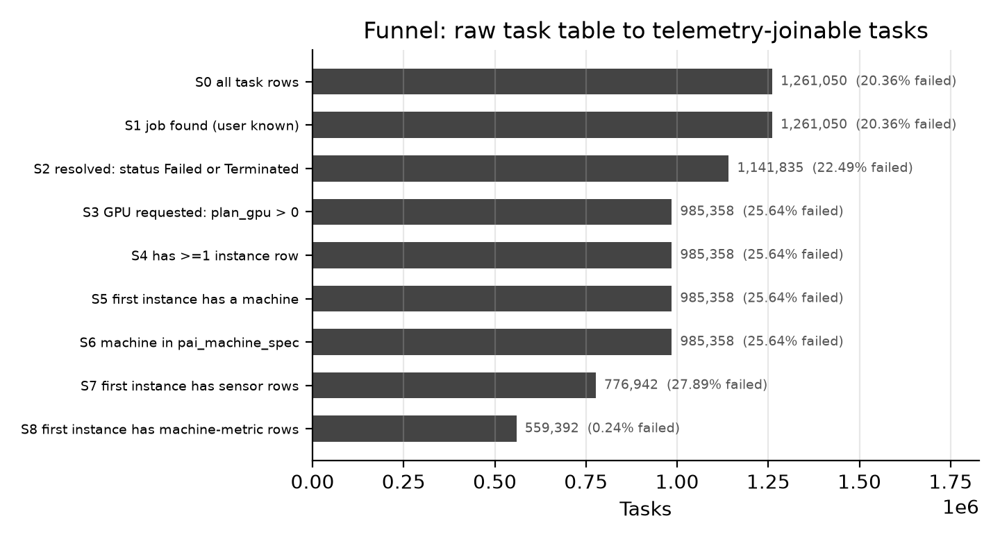
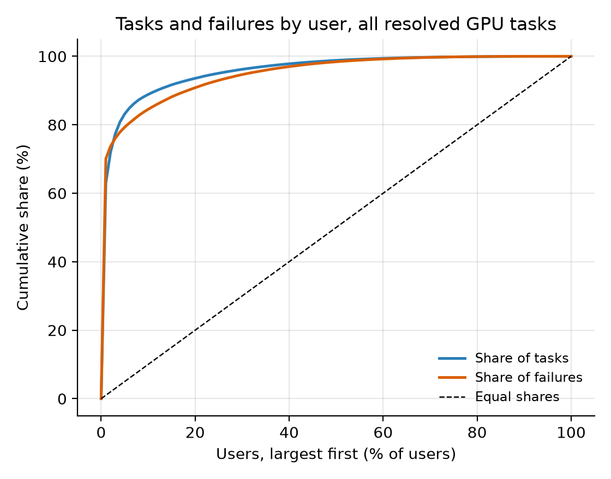
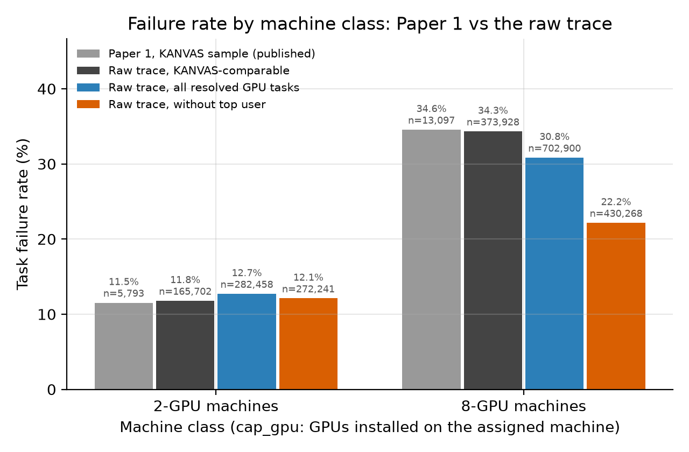
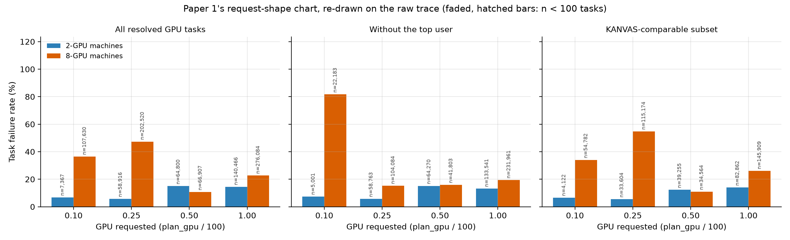
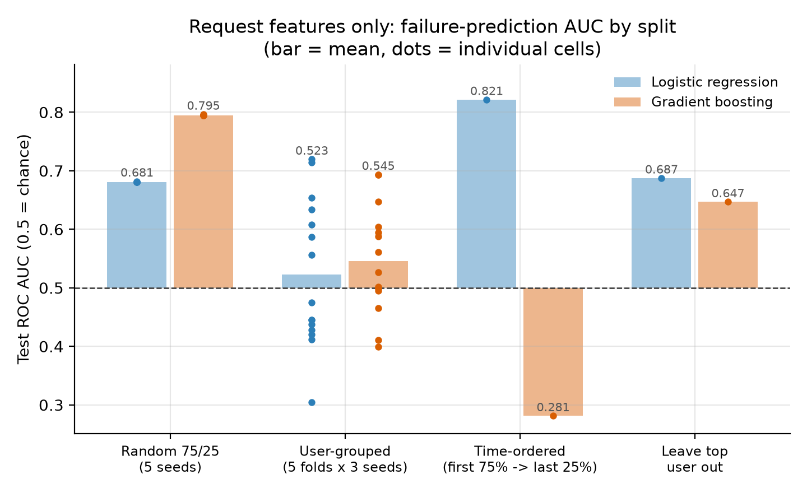
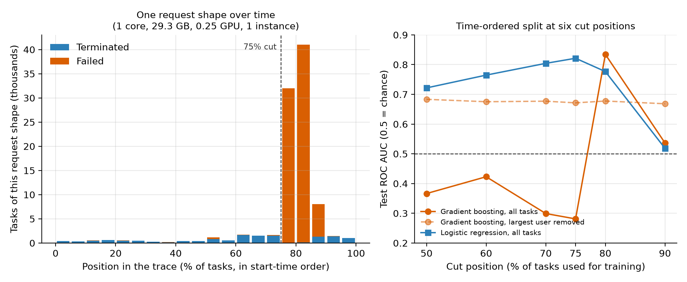

# One User Dominates: An Audit and User-Grouped Re-check of Task-Failure Prediction on the Alibaba PAI GPU Trace (cluster-trace-gpu-v2020)

**Sajish Krishnan**, Independent researcher

---

## Abstract

The Alibaba PAI 2020 GPU trace (cluster-trace-gpu-v2020) is used to train and evaluate task-failure predictors. We audit its seven raw tables and quantify two properties that shape any such evaluation. First, one user submits 28.71% of the 985,358 resolved GPU tasks and 49.21% of their failures. Second, some columns nearly copy the outcome, as the KANVAS project's code already notes: the task end time is missing for 99.74% of Failed tasks and no Terminated task, and a task's own machine-metric rows exist for 0.53% of Failed tasks against 76.16% of Terminated ones.

We then predict failure from the resource request alone under three split protocols. On random splits gradient boosting has a mean AUC of 0.7950. With whole users held out, the means are 0.5452 for gradient boosting and 0.5226 for logistic regression. KANVAS already reported this collapse on an 18,890-task subset (about 0.45); we extend it to the full trace. On a time-ordered split, logistic regression scores 0.8213 and gradient boosting 0.2811. We trace the second number to one request shape, almost all of it the largest user's: that user's 10,635 training tasks of the shape fail 6.51% of the time, and their 82,980 test tasks 95.41%. With that user removed, gradient boosting scores 0.6714. Adding user identity lifts the random-split score to 0.9121 and does not help on unseen users.

Last, we re-check two results from an earlier report (Paper 1) built on that subset. The failure-rate gap between 8-GPU and 2-GPU machines holds on the full trace (30.84% against 12.71%) and without the largest user (22.16% against 12.11%). The high failure rate of quarter-GPU requests on 8-GPU machines needs qualifying: it is 47.36% on the full trace and 15.28% without the largest user.

We release the code, aggregate results and paigpu, a module that builds the task table and the splits. No trace rows are released.

**Keywords:** failure prediction, data leakage, grouped evaluation, cluster traces, Alibaba PAI.

## 1. Introduction

Two facts about the Alibaba PAI 2020 GPU trace [1] shape any failure-prediction result built on it.

The first is concentration. Among the 985,358 resolved tasks that requested a GPU, one user of 1,314 submitted 28.71% of the tasks and 49.21% of the failures. The second is that the trace records failed tasks differently from successful ones. A Failed task almost never has an end time (99.74% lack one) and a Terminated task always does. A Failed task's first instance almost never has rows in the machine-metric table (0.53% do) and a Terminated task's usually does (76.16%). Duration, usage over the run, and any dataset that requires a task's own machine metrics all carry the label with them. Section 2 gives the table.

Neither fact is hidden. We know the first from one source. The KANVAS project [3], which publishes an 18,890-task feature matrix derived from this trace, states on its dataset card that one user holds 31% of its tasks and 54% of its failures, and that models scoring about 0.75 AUC on a random split fall to about 0.45 when the split is grouped by user. The project's notebook shows how that was measured: one 70/15/15 partition by user in which the largest user is always in training, three initialisation seeds (0.4535 ± 0.0418), a check on four different grouped partitions (0.4074, 0.4485, 0.4848 and 0.4163), and a mechanism. Among training users a single-core request failed 80.4% of the time against 18.1% for other requests; among held-out users the same contrast was 34.4% against 22.8%. The credit for the user-grouped collapse on this trace, and for explaining it, is theirs.

This report extends that result to the full trace, where the user identifiers are available to us and the largest user can be held out as well as trained on. On request features, with five user-grouped folds repeated over three seeds, gradient boosting averages 0.5452 and logistic regression 0.5226, and single folds scatter from 0.3045 to 0.7195. Our numbers and KANVAS's are not the same measurement. Theirs come from a 1.9% sample with machine-telemetry features and a test set that never contains the largest user. Ours use four request columns on every resolved GPU task, and three of every fifteen folds test on the largest user. Both say that a random-split score on this trace does not carry over to unseen users. On the folds comparable to theirs, the twelve without the largest user, our fold scores run from 0.3996 to 0.6536, and their four values sit inside that range.

The second fact is KANVAS's observation too. The module docstring of `kanvas/data.py` in its code [3] says that machine-metric rows exist almost only for workers that finished normally (42% of Terminated instances against 0.09% of Failed ones), that 99% of failed tasks' instances never record an end time, and that a join on a task's own worker therefore removes nearly every failure. KANVAS built its features to avoid that. What we add on this point is the measurement: per-task coverage on the full analysis base, the job-table figure, and what each column scores as a predictor (Table 2).

Two things here go beyond what KANVAS reported: what a time-ordered split of this trace contains, where one burst of failing submissions, almost all of it one user's, is 32.9% of the test tasks and 74.6% of the test failures; and a re-check of an earlier report of ours.

That report, Paper 1 [2], described three associations in the KANVAS matrix. Machine class was the largest single split in failure rate. The pooled link between machine busyness and failure was mostly an artefact of mixing two machine classes. Quarter-GPU requests on 8-GPU machines failed at an unusually high rate. Paper 1 repeated the card's one-user figures and said it could not test whether any of the three was one user's workload. Here we test the first and the third. The busy-machine association needs KANVAS's machine-context features, which we did not rebuild.

This report is part of one line of work: the reliability of GPU-accelerated and data-intensive systems, followed through four steps — failures are characterised, injected, detected, and verified as recovered. Paper 1 (Zenodo, doi:10.5281/zenodo.24294903) characterised GPU task failures in KANVAS, an 18,890-task subset of the Alibaba PAI 2020 trace with user and job identifiers removed. This report goes back to the raw trace, about 985,000 resolved GPU tasks from 1,314 users. It qualifies Paper 1's scope: Paper 1's results come from 1.9% of those tasks and could not be tested across users, so here they are re-checked on the full trace, with and without the largest user, and reported as they come out. It extends Paper 1 with what the subset could not show: the funnel from raw trace to subset, how concentrated failure is by user, and how much failure-prediction accuracy survives when training and test data are split by user or by time. The other steps are separate pieces of work: a chaos experiment that injects GPU telemetry loss (krkn Scenario C, krkn-chaos/krkn#1673, open), alert rules that detect that loss and are tested to stay quiet on a routine pod replacement (the S1 alert pack), and planned work on verifying recovery (not yet written).

Grouped cross-validation is not new, and neither is the observation that random splits flatter models on operational data [4, 5, 6]. We found three published studies of failure prediction on this trace [8, 9, 10], and as we read them all three evaluate on time-ordered splits. We did not search systematically, and there may be others. What we add is an audit of the trace those evaluations rest on, the measured size of each effect, and code that makes the grouped and time-ordered splits one function call each.

## 2. The trace and the frame

**Source.** The trace [1] is distributed as seven tables: jobs, tasks, instances, per-instance sensor readings, group tags, machine specifications and per-machine metrics. We downloaded all seven and checked each file against the SHA-256 values in the trace README. The trace carries no licence, which limits what we can release (Sections 6 and 7).

**The frame.** We call our task-level table the frame. It has one row per row of the trace's task table, 1,261,050 in all. Each task gets its user from the job table and its machine from its first instance, the instance with the earliest start time. The machine specification table gives the number of GPUs installed on that machine. Following Paper 1, that number is the task's machine class. It takes two values in this trace, 2 and 8.

**The label.** Task status takes four values: Terminated, Failed, Running and Waiting. The trace README says only Terminated tasks are successful. We label Failed as 1 and Terminated as 0, and drop Running and Waiting tasks as unresolved. "Failure rate" in this report always means Failed ÷ (Failed + Terminated) within the group being described. It is a share of ended tasks and is not a cluster failure rate. The trace does not say why a task failed. If most failures are program errors, as a study of deep-learning jobs on another platform reports [7], then failure is tied to who submitted the task and what they ran. That is the reason to look at users.

**The funnel.** Table 1 gives the stages from the raw task table to the analysis base and beyond (Figure 1).

| Stage | Tasks | Failed | Failed % | Users |
|---|---|---|---|---|
| S0 all task rows | 1,261,050 | 256,762 | 20.36 | 1,433 |
| S2 resolved (Failed or Terminated) | 1,141,835 | 256,762 | 22.49 | 1,399 |
| **S3 GPU requested (analysis base)** | **985,358** | **252,667** | **25.64** | **1,314** |
| S7 first instance has sensor rows | 776,942 | 216,693 | 27.89 | 1,222 |
| S8 first instance also has machine-metric rows | 559,392 | 1,346 | 0.24 | 1,141 |

*Table 1. The funnel. Stages S1 and S4 to S6 lose no tasks and are omitted: every task has a job, and every task in the analysis base has a first instance, a machine and a machine specification. The Failed % column is computed from the two columns to its left.*

*Figure 1. The funnel from the raw task table to tasks whose first instance has machine-metric rows.*

The analysis base is stage S3: resolved tasks that requested a GPU. Every result in Section 4 is on this base unless it says otherwise. The frame was built by a different script from the one that produced our first audit of the trace. We recounted every stage from the frame and compared tasks, failures and distinct users with the audit's funnel. All nine stages match.

**Columns that copy the label.** KANVAS's code states the first two effects below at instance level (Section 1). Table 2 lists three conditions on a task's own records, measured on the analysis base.

| Column or condition | Failed tasks | Terminated tasks | As a single yes/no predictor of failure |
|---|---|---|---|
| Task `end_time` is missing | 252,017 of 252,667 (99.74%) | 0 of 732,691 | AUC 0.9987 |
| First instance has machine-metric rows | 1,346 of 252,667 (0.53%) | 558,046 of 732,691 (76.16%) | AUC 0.8782 (for their absence) |
| First instance has sensor rows | 216,693 of 252,667 (85.76%) | 560,249 of 732,691 (76.46%) | AUC 0.5465 |

*Table 2. Label-proxy columns. The last column is arithmetic on the two rates in the row (0.5 plus half the difference between them), with no model fitted. A longer version, with the other tables and the columns that are fixed before launch, is in `leakage-table.md`.*

The first row means that task duration, and any quantity averaged or counted over a task's run, cannot be computed for a failed task without deciding what to do about the missing end time, and that decision is a decision about the label. The same holds in the job table, where 90.01% of Failed jobs lack an end time and no Terminated job does. The second row is why stage S8 of the funnel keeps 559,392 tasks and only 1,346 failures. A dataset that requires a task's own machine-metric rows has selected on the outcome. The third row is a weaker effect of the same kind, and sensor values describe the run itself in any case.

We do not know why the trace is like this. The machine-metric table's time columns are never null, so our guess is that rows are written only for instances that record an end. That is an inference from the tables. An open question on the trace's issue tracker asks about missing end times and has no answer.

No feature in this report touches a task's end time, duration or own telemetry.

**KANVAS and Paper 1's sample.** Paper 1's dataset is the KANVAS feature matrix [3]: 18,890 tasks, equal in size to 1.9% of the analysis base. KANVAS keeps a task only if other jobs' workers left machine-metric readings on the task's machine in the hour before it started, and then draws a stratified random sample. We read KANVAS's code to get the filter and did not run it. Applying the filter to every labelled task, without the sampling step, keeps 539,630 tasks from 1,157 users. We call this the KANVAS-comparable subset. It is not nested inside the analysis base, because KANVAS's filter keeps tasks that request no GPU.

Its failure rate is 27.40%, and Paper 1's sample has 27.50%. The largest user of the analysis base holds 31.01% of the subset's tasks and 54.61% of its failures, close to the 31.04% and 54.22% in KANVAS's notebook. Paper 1's sample is consistent with a random draw from this subset, and it carries the same one-user weight. We cannot rebuild the exact 18,890 rows: KANVAS's sampling, its tie-breaking on the first instance and its clipping of extreme values are not reproduced here.

## 3. Methods

### 3.1 The Paper 1 re-check

We took Paper 1's definitions from its public repository. Machine class is the number of GPUs installed on the task's machine. The quarter-GPU cell is tasks with `plan_gpu` equal to 25 (the trace records GPU requests as a percentage of one GPU) on 8-GPU machines, contrasted with the same request on 2-GPU machines.

Each quantity is computed on four populations: the analysis base, the analysis base without the largest user, the KANVAS-comparable subset, and that subset without the same user. "The largest user" always means the user with the most tasks in the analysis base. Their identifier is never written to any output. Removing one user tests whether a result is that user. It does not test whether a result is a few users (Section 6).

### 3.2 Features

The prediction models see four columns, all fixed when the task is submitted: requested CPU (`plan_cpu`), requested memory (`plan_mem`), requested GPU (`plan_gpu`) and the number of instances (`inst_num`). This is Paper 1's "request" feature family. We call one combination of the four values a request shape.

The task's own telemetry and anything derived from its end time are excluded for the reason given in Section 2. The trace's `gpu_type` column is excluded because the trace README defines it as the GPU type assigned to the task, so it describes the machine and would let machine class into a request-only model.

The user identifier is not a feature in the main grid. Section 4.6 adds it in a separate run, encoded as the user's failure rate in the training part (scikit-learn's target encoder, cross-fitted, default smoothing). A user absent from training gets the training base rate.

### 3.3 Three split protocols and one single-user test

**Random.** A shuffled 75/25 split of tasks, repeated for seeds 0 to 4. Each split trains on 739,018 tasks and tests on 246,340. The same users appear on both sides. Paper 1 used a random split, and the 0.75 on the KANVAS card is a random-split score.

**User-grouped.** Every user's tasks go into exactly one of five folds, and each fold is held out once. The assignment is repeated for seeds 0 to 2, giving 15 train/test cells per model. Users are shuffled by the seed, and each is then placed in the fold that currently holds the fewest tasks. The folds cannot be even: the largest user fills most of whichever fold it lands in (69.51% to 86.62% of that fold's test tasks across the three seeds). Test folds range from 143,230 to 406,931 tasks.

**Time-ordered.** Tasks are sorted by start time. The earliest 75% (739,018 tasks) train the model and the latest 25% (246,340) test it. Users can appear on both sides. The grid has one cut, so one cell per model. Section 4.5 repeats the split at five other cut positions and with the largest user removed.

**Leave-top-user-out.** Train on every other user (702,509 tasks, 1,313 users) and test on the largest user alone (282,849 tasks). One cell per model.

### 3.4 Models and metric

Two scikit-learn models with fixed seeds and no tuning: a logistic regression on log-transformed, standardised features with missing values set to the training median, and a histogram gradient-boosting classifier with its default settings. Those defaults include early stopping on a random hold-out of the training rows. The hold-out is taken inside the training part and is not grouped by user. The scores are not the best achievable from these features. The aim is the comparison between splits with everything else held still.

The metric is ROC AUC on the test part. 0.5 is chance, and below 0.5 means the model ranks failed tasks below successful ones more often than not. For every cell we also score the same predictions on two subsets of the test tasks: the largest user's, and everyone else's.

Where a split has several cells we report the mean, the sample standard deviation, the minimum and the maximum. The 15 user-grouped cells are not independent, since the three seeds re-partition the same users. Their standard deviation describes spread between folds and is not a standard error. We report no confidence intervals anywhere.

### 3.5 The `paigpu` module

The splits are packaged so that others can use them without re-deriving the joins. `load_trace()` returns the frame, by default the analysis base. `user_folds(k, seed)` returns a fold number for every task such that no user spans two folds. `time_split(frac)` marks the earliest `frac` of tasks by start time as train and the rest as test, with ties broken by job and task name. The frame carries no end time, no duration and no telemetry values. It does carry two coverage flags kept for the funnel, `has_sensor` and `has_metric`; the second is the middle row of Table 2 and must not be used as a feature. `SCHEMA.md` documents every column.

## 4. Results

### 4.1 One user dominates the trace

The largest user has 28.71% of the tasks in the analysis base and 49.21% of the failures. That user's failure rate is 43.96%. Everyone else's, pooled, is 18.27%. With users sorted from largest to smallest by task count, the largest 1% (14 users) hold 62.98% of tasks and 68.30% of failures. The 14 users with the most failures are a partly different set, and they hold 70.09% of failures (Figure 2).

Of the largest user's 282,849 tasks, 272,632 ran on 8-GPU machines. Any comparison between machine classes, or between request sizes within the 8-GPU class, could therefore be a description of this one user. Each result below is given with and without them.

*Figure 2. Cumulative share of tasks and of failures by user on the analysis base. Each curve sorts users by its own quantity: the task curve by task count, the failure curve by failure count. At the same point on the horizontal axis the two curves can describe different users.*

### 4.2 The machine-class gap

| Population | 2-GPU machines | 8-GPU machines |
|---|---|---|
| Paper 1, KANVAS sample (published) | 11.53% (n = 5,793) | 34.56% (n = 13,097) |
| KANVAS-comparable subset | 11.79% (n = 165,702) | 34.32% (n = 373,928) |
| Analysis base | 12.71% (n = 282,458) | 30.84% (n = 702,900) |
| Analysis base, without the largest user | 12.11% (n = 272,241) | 22.16% (n = 430,268) |
| KANVAS-comparable, without the largest user | 10.92% (n = 159,054) | 23.33% (n = 213,214) |

*Table 3. Failure rate by machine class. Figure 3 shows the first four rows.*

On the KANVAS-comparable subset the two rates are close to Paper 1's published values. On the full analysis base the gap is narrower. Without the largest user it narrows again, to 22.16% against 12.11%. Nearly all of the movement is on the 8-GPU side, where the largest user's tasks are.

The gap Paper 1 reported is on the full trace and is not produced by the largest user alone. That is as far as this check goes, for two reasons.

First, the gap without the largest user is uneven across request sizes (Table 4 in the next section). It is close to zero for half-GPU requests, 15.86% against 15.13%. It is very large for 0.10-GPU requests, where one cell of 22,183 tasks from 65 users fails at 81.69%. That cell supplies 19.00% of all 8-GPU failures in this population. With 0.10-GPU requests left out of both classes, the rates are 18.93% against 12.20%. A gap is still there, but about a third of the pooled one rests on a cell we have not broken down by user.

Second, we did not re-test Paper 1's statement that machine class is the largest single split. Paper 1 made it among KANVAS's ten features. On the raw trace the split by user is larger: 43.96% for the largest user against 18.27% for everyone else.

*Figure 3. Failure rate by machine class: Paper 1's published values and three populations from the raw trace.*

### 4.3 The quarter-GPU cell: a qualification of Paper 1

Paper 1 reported that quarter-GPU requests on 8-GPU machines failed 54.11% of the time (n = 4,077), against 6.20% for the same request on 2-GPU machines (n = 1,178). It reported the cell next to the one-user concentration from the dataset card, and said it could not check whether the cell was disproportionately one user's.

The cell reproduces on the raw trace. On the KANVAS-comparable subset it is 54.73% against 5.47%. On the full analysis base it is 47.36% (202,520 tasks from 415 users) against 5.79% (58,916 tasks from 297 users), a ratio of 8.18. The cell holds 37.96% of all failures in the analysis base.

Table 4 gives the four request sizes Paper 1 charted, with and without the largest user.

| GPU requested | All: 2-GPU | All: 8-GPU | Without largest user: 2-GPU | Without largest user: 8-GPU |
|---|---|---|---|---|
| 0.10 | 6.72% (n = 7,367) | 36.45% (n = 107,630) | 7.40% (n = 5,001) | 81.69% (n = 22,183) |
| **0.25** | **5.79% (n = 58,916)** | **47.36% (n = 202,520)** | **5.78% (n = 58,763)** | **15.28% (n = 104,084)** |
| 0.50 | 15.03% (n = 64,800) | 10.66% (n = 66,907) | 15.13% (n = 64,270) | 15.86% (n = 41,803) |
| 1.00 | 14.45% (n = 140,466) | 22.67% (n = 276,084) | 13.12% (n = 133,541) | 19.34% (n = 231,961) |

*Table 4. Failure rate by requested GPU size and machine class on the analysis base, with and without the largest user. Other request sizes exist and are in the released results. See Figure 4.*

Without the largest user, the quarter-GPU cell on 8-GPU machines falls from 47.36% to 15.28% (104,084 tasks from 414 users), and its share of all failures falls from 37.96% to 12.39%. The largest user accounts for 98,436 of the cell's 202,520 tasks and 80,016 of its 95,916 failures. Within this cell that user fails 81.29% of the time, and the other users, pooled, 15.28%.

The time-split analysis in Section 4.5 narrows this further. Of the largest user's 98,436 tasks in the cell, 93,501 have one exact request shape (one CPU core, 29.3 GB of memory, a quarter GPU, one instance), and those account for 79,856 of that user's 80,016 failures in the cell. Most of them were submitted within four and a half days near the end of the trace (Figure 6). The KANVAS notebook describes its dominant user's "recurring single-core job" as failing 88% of the time. That is probably this workload seen through KANVAS's sample. We did not match tasks between the two.

Three comparisons describe what is left without the largest user.

1. *Other requests on the same machines.* All other request sizes on 8-GPU machines pooled fail at 24.36%, or 20.18% if the 0.10-GPU cell is also set aside. The quarter-GPU cell, at 15.28%, is below both. It is also below the half-GPU and one-GPU cells in Table 4.
2. *The same request on 2-GPU machines.* The cell is still higher on 8-GPU machines: 15.28% against 5.78%, a ratio of 2.64, down from 8.18.
3. *The machine-class gap for all requests.* The pooled gap is 10.05 points (ratio 1.83), and 6.73 points with 0.10-GPU requests left out. The quarter-GPU difference is 9.50 points (ratio 2.64). So it is about the size of the pooled gap in points and larger as a ratio. We report no intervals, and we have not tested whether this residual is a few users.

The KANVAS-comparable subset gives the same picture without the largest user: 16.06% against 5.45%.

We call this a qualification of Paper 1 and not a correction, for a plain reason. Paper 1's numbers for the cell are right, on its sample and on the full trace. What it could not do was say whose tasks they were, and it said so. The raw trace answers the question Paper 1 left open: the cell stands far above its neighbours because of one user's workload, and pooled, the other 414 users in the cell do not show it. For them the request fails more often on 8-GPU machines than on 2-GPU machines, and less often than other requests on 8-GPU machines.

The outputs do not say why that user's job failed. That user fails 81.29% of the time in this cell and 23.76% on their other 8-GPU requests, and has only 153 quarter-GPU tasks on 2-GPU machines, so the request shape and the machine class cannot be separated from the user.

The 0.10-GPU row is a second caution. Without the largest user the 8-GPU cell is 81.69%. With them it is 36.45%, because their 0.10-GPU tasks on these machines mostly succeed. We have not checked whether the 81.69% is one or two users. Removing one user does not turn the rest into a population of typical users.

*Figure 4. Paper 1's request-shape chart redrawn on the raw trace: all resolved GPU tasks, the same without the largest user, and the KANVAS-comparable subset.*

### 4.4 The evaluation grid

All 44 cells ran. Table 5 summarises them and Figure 5 shows every cell.

| Split | Model | Cells | Mean AUC | SD | Min | Max | Mean AUC, users other than the largest |
|---|---|---|---|---|---|---|---|
| Random 75/25 (seeds 0–4) | Logistic regression | 5 | 0.6809 | 0.0007 | 0.6802 | 0.6820 | 0.5702 |
| Random 75/25 (seeds 0–4) | Gradient boosting | 5 | 0.7950 | 0.0008 | 0.7943 | 0.7963 | 0.7375 |
| User-grouped (5 folds × seeds 0–2) | Logistic regression | 15 | 0.5226 | 0.1249 | 0.3045 | 0.7195 | 0.5065 |
| User-grouped (5 folds × seeds 0–2) | Gradient boosting | 15 | 0.5452 | 0.0913 | 0.3996 | 0.6935 | 0.5340 |
| Time-ordered (first 75%, last 25%) | Logistic regression | 1 | 0.8213 | n/a | n/a | n/a | 0.5337 |
| Time-ordered (first 75%, last 25%) | Gradient boosting | 1 | 0.2811 | n/a | n/a | n/a | 0.6587 |
| Leave-top-user-out | Logistic regression | 1 | 0.6874 | n/a | n/a | n/a | n/a |
| Leave-top-user-out | Gradient boosting | 1 | 0.6467 | n/a | n/a | n/a | n/a |

*Table 5. Test AUC, request features only, analysis base. The last column scores the same predictions on test tasks from users other than the largest. It is empty for leave-top-user-out, whose test set is that user alone.*

*Figure 5. Test AUC by split. Bars are means and dots are individual cells.*

**Random against user-grouped.** On random splits gradient boosting averages 0.7950 and logistic regression 0.6809, and the five seeds differ by at most 0.002. With whole users held out the means are 0.5452 and 0.5226. This is the result KANVAS reported on its subset, now on the full trace.

The user-grouped means are lifted by the three folds per model that contain the largest user. The 12 folds without that user average 0.5121 for gradient boosting (0.3996 to 0.6036) and 0.5084 for logistic regression (0.4115 to 0.6536). Those 12 are the folds built like KANVAS's test sets, and KANVAS's four values, 0.4074 to 0.4848, fall inside both ranges, apart from the lowest, which is just under our logistic-regression minimum. Over all 15 cells, six gradient-boosting cells and eight logistic-regression cells are below 0.5, though two of those six are within 0.001 of it. The two models fall on opposite sides of 0.5 in 10 of the 15 folds. In one fold logistic regression scores 0.6334 and gradient boosting 0.4111, and in another the order is reversed, 0.4204 and 0.6036.

So the user-grouped result is a wide scatter around 0.5, a little above it on average. The fitted relation between request and failure helps on some held-out groups of users and hurts on others. KANVAS found the same thing for one feature, the single-core request, whose meaning inverted between its training and held-out users. Because our two models disagree about direction in most folds, we cannot put the direction down to the users alone.

The fall is not only about the largest user. Scored on test tasks from everyone else, random-split gradient boosting still averages 0.7375, against 0.5340 for the user-grouped split on the same basis. For logistic regression the two are 0.5702 and 0.5065.

**Leave-top-user-out.** Trained on the other 1,313 users and tested on the largest user's 282,849 tasks, logistic regression scores 0.6874 and gradient boosting 0.6467, above the user-grouped means. The three user-grouped folds that contain the largest user show how far that can be relied on. Gradient boosting is stable across them: 0.6928, 0.6473 and 0.6935. Logistic regression scores 0.7195, 0.3045 and 0.7141. In the middle fold it ranks every part of the test set backwards: 0.3044 on the largest user's tasks and 0.3166 on the rest. For logistic regression, whether this user's failures can be ranked from other users' requests depends on which other users are in training.

### 4.5 The time-ordered split turns on one burst of failures

On the time-ordered split logistic regression scores 0.8213 and gradient boosting 0.2811. A score that far below chance looks like a bug, so we tested it in four ways. The results are in `results/time_split_diagnostics.json`.

*The split is right.* We rebuilt the split with a separate sort and compared it with the module's: no task is assigned differently, and the latest training start time is no later than the earliest test start time.

*The two periods are different populations.* The failure rate is 19.75% in the training period and 43.31% in the test period. The largest user is 21.03% of the training tasks and 51.73% of the test tasks. That user's failure rate is 22.37% in training and 70.30% in test. Everyone else's goes the other way, 19.05% to 14.40%.

*Removing the largest user removes the effect.* Table 6 scores the grid's predictions on parts of the test set, and then refits with the largest user taken out of both training and test.

| | Largest user's test tasks | Everyone else's test tasks | All test tasks | Largest user removed from both sides, same cut | Removed, then re-cut at 75% |
|---|---|---|---|---|---|
| Logistic regression | 0.7959 | 0.5337 | 0.8213 | 0.5154 | 0.5240 |
| Gradient boosting | 0.2067 | 0.6587 | 0.2811 | 0.6714 | 0.6864 |
| Request-shape lookup (no model) | 0.2080 | 0.6765 | 0.3069 | n/a | n/a |

*Table 6. Time-ordered split. The first three columns score one set of predictions on three sets of test tasks. The last two refit without the largest user. The lookup row is explained below.*

Without the largest user gradient boosting scores 0.6714, close to the 0.6587 it gets on other users' tasks when that user is present, and logistic regression drops to 0.5154. The sub-chance score and the high score are both that user.

*One request shape accounts for it.* Table 7 lists the request shapes with the most test tasks.

| Request shape (CPU cores, memory GB, GPU, instances) | Training tasks | Failed in training | Test tasks | Failed in test | Largest user's share of the shape's test tasks | Mean test score, gradient boosting | Mean test score, logistic regression |
|---|---|---|---|---|---|---|---|
| 1, 29.3, 0.25, 1 | 10,715 | 6.55% | 83,459 | 95.43% | 99.43% | 0.0733 | 0.2896 |
| 6, 29.3, 1.00, 1 | 209,902 | 19.26% | 50,644 | 19.73% | 22.45% | 0.1930 | 0.1896 |
| 6, 29.3, 0.10, 1 | 67,860 | 28.51% | 15,288 | 17.18% | 96.06% | 0.2839 | 0.2017 |
| 6, 29.3, 0.25, 1 | 75,241 | 9.14% | 14,920 | 8.66% | 7.58% | 0.0957 | 0.1970 |
| 18, 58.6, 1.00, 1 | 36,411 | 20.07% | 6,822 | 19.50% | 13.56% | 0.2077 | 0.2243 |

*Table 7. The five request shapes with the most test tasks on the time-ordered split. The trace records CPU as a percentage of one core and GPU as a percentage of one GPU; we show cores and GPUs. All shapes with at least 100 tasks in either period are in `results/time_split_by_request_shape.csv`.*

The first row is a third of the test set (33.88%). In training it is a small, safe shape: 10,715 tasks, 6.55% failed. In test it is 83,459 tasks, 95.43% failed, and 99.43% of them belong to the largest user. Gradient boosting learned the training-period rate and gives the shape a mean score of 0.0733, the lowest in the table, so it places nearly all of the shape's failures near the bottom of its ranking. Logistic regression cannot fit a single shape. Its fitted trend happens to give this one a higher score (0.2896) than the larger shapes around it, which works in its favour here. We did not refit logistic regression with the shape taken out, so we cannot say how much of its 0.8213 this one shape accounts for. Table 6 shows only that the high score goes when the largest user is removed.

Figure 6 follows the shape through the trace in bins of 5% of tasks. Up to the cut it is between 171 and 1,716 tasks per bin, and outside one bin its failure rate stays at or below 7.16%. In the three bins after the cut there are 80,988 tasks of this shape, of which 79,570 failed. Those bins run from day 58.38 to day 62.87 of a trace 68.94 days long. In the last two bins the shape is back to 1,420 and 1,051 tasks with failure rates of 2.75% and 3.62%.

The burst is predominantly, not exclusively, one user's. Of the 80,988 tasks, 80,509 are the largest user's. The other 479 come from one second user, all of them in the first of the three bins, and 472 of them failed. A second user failing the same shape in the same window could mean a shared job template or a platform event and not something particular to one user. The trace does not let us tell these apart.

*Figure 6. Left: tasks of one request shape in 20 equal-count time bins, failed and successful. Right: test AUC at six cut positions.*

Three further checks agree with this reading.

- *A lookup with no model in it.* Score every test task by the training-period failure rate of its exact request shape. That lookup gets 0.3069 on the test set and 0.2080 on the largest user's tasks (Table 6), and its ranking of test tasks correlates with gradient boosting's at 0.9334 (Spearman). Gradient boosting is behaving like a table of training-period rates per shape. Since the lookup involves no fitting library, the sub-chance score is not something our model code produces.
- *Pairs.* AUC counts pairs of one failed and one successful task. Of the test pairs, 22.76% are within the largest user's tasks, 11.70% within everyone else's, and 65.55% set one against the other; 61.20% of all pairs are a failed task of the largest user against a successful task of someone else. On the cross-user pairs gradient boosting scores 0.2395 and logistic regression 0.8815.
- *Other cut positions.* Table 8 moves the cut. From 50% to 75% gradient boosting stays below 0.5 and logistic regression climbs. At 80%, the first of the three burst bins is in the training data, and gradient boosting scores 0.8343. With the largest user removed, gradient boosting scores between 0.6684 and 0.6833 wherever the cut is.

| Training share | Largest user's share of test | Largest user's failure rate, train → test | Gradient boosting | Logistic regression | Gradient boosting, largest user removed | Logistic regression, largest user removed |
|---|---|---|---|---|---|---|
| 50% | 39.96% | 16.70% → 55.87% | 0.3664 | 0.7217 | 0.6833 | 0.5340 |
| 60% | 43.36% | 19.63% → 59.90% | 0.4229 | 0.7647 | 0.6752 | 0.5394 |
| 70% | 47.23% | 23.04% → 65.42% | 0.2992 | 0.8043 | 0.6770 | 0.5221 |
| 75% | 51.73% | 22.37% → 70.30% | 0.2811 | 0.8213 | 0.6714 | 0.5154 |
| 80% | 46.98% | 35.17% → 62.02% | 0.8343 | 0.7766 | 0.6775 | 0.4948 |
| 90% | 30.90% | 46.72% → 21.07% | 0.5366 | 0.5185 | 0.6684 | 0.5061 |

*Table 8. The time-ordered split at six cut positions. "Removed" means the largest user is taken out of training and test at the same cut.*

Grouping test tasks by what training said about their shape gives the same answer in one line. Shapes that were below the base rate in training and above it in test make up 35.90% of the test tasks and 77.01% of the test failures, and 98.38% of those tasks are the largest user's.

So the 0.2811 is explained, and it is a property of the trace. About 81,000 tasks of one shape, nearly all of them one user's, were submitted over four and a half days and nearly all failed, and a 75% cut by time puts that burst just inside the test set. A model that memorises shapes is wrong about it and a model that fits a trend is right about it by the direction of the trend. Neither score says how well request features predict failure after a gap in time. For that, the columns without the largest user are the better guide: 0.6684 to 0.6833 for gradient boosting, and 0.4948 to 0.5394 for logistic regression.

What we cannot say is why those tasks failed, or whether they are retries of one job. The trace has no failure reason.

### 4.6 User identity as a feature

One published feature set for failure prediction on this trace lists the user identifier first [8]. We did not run that pipeline. On our frame we asked how much a user feature adds to the request columns, and how far it gets alone (Table 9).

| Split | Model | Request only | Request + user | User only | Request + user, users other than the largest | User only, users other than the largest |
|---|---|---|---|---|---|---|
| Random (mean of 5) | Gradient boosting | 0.7950 | 0.9121 | 0.8288 | 0.9094 | 0.8737 |
| Random (mean of 5) | Logistic regression | 0.6809 | 0.8542 | 0.8289 | 0.8647 | 0.8739 |
| User-grouped (mean of 15) | Gradient boosting | 0.5452 | 0.5007 | 0.5000 | 0.5259 | 0.5000 |
| User-grouped (mean of 15) | Logistic regression | 0.5226 | 0.5447 | 0.5000 | 0.5323 | 0.5000 |
| Time-ordered | Gradient boosting | 0.2811 | 0.6238 | 0.7830 | 0.8520 | 0.8120 |
| Time-ordered | Logistic regression | 0.8213 | 0.7642 | 0.7859 | 0.8163 | 0.8108 |
| Leave-top-user-out | Gradient boosting | 0.6467 | 0.4351 | 0.5000 | n/a | n/a |
| Leave-top-user-out | Logistic regression | 0.6874 | 0.6877 | 0.5000 | n/a | n/a |

*Table 9. Test AUC with user identity added to the request features, and alone. User identity is the user's training-period failure rate; users not in training get the base rate. The request-only columns are the grid of Table 5, reproduced to six decimals by the ablation script.*

On random splits, knowing the user is worth more than knowing the request. The user column alone scores 0.8288 with gradient boosting and 0.8289 with logistic regression, above either model on the four request columns (0.7950 and 0.6809). Together they reach 0.9121 and 0.8542. So a model that looks up each user's past failure rate, and nothing else, beats a request-only model by a clear margin when the same users are on both sides.

Under the user-grouped split the user column is constant on the test side, because no test user was in training, and it scores exactly 0.5000 alone. That is by construction and is there as a control. Added to the request features it does not help gradient boosting (0.5007, with single folds from 0.2267 to 0.6550) and logistic regression moves from 0.5226 to 0.5447, well inside the fold-to-fold spread. On the leave-top-user-out test it costs gradient boosting a good deal, 0.4351 against 0.6467. A model that has learned to lean on the user column has less to offer a user it has no history for.

The time-ordered split sits between the two, since 98.71% of its test tasks come from users seen in training. On users other than the largest, adding the user lifts gradient boosting from 0.6587 to 0.8520 and logistic regression from 0.5337 to 0.8163, and the user column alone scores 0.8120 and 0.8108. On the largest user's test tasks it cannot help (one user, one value), and the request-plus-user models score 0.3778 and 0.3914 there, still caught by the burst.

Read together: with the user in the feature set, most of what a random or time-ordered score measures on this frame is recognition of users, and none of it transfers to new ones. This is our frame and our encoding. It says nothing about the scores any published model would get.

## 5. Discussion

**What to take from the audit.** Three statements about this trace hold whatever model is used. One user is 28.71% of resolved GPU tasks and 49.21% of failures. End time and own machine-metric coverage copy the label (Table 2). And the last quarter of tasks in time order, which spans the final 15% of the trace's time span, is 51.73% one user, and a single burst of failing submissions is 32.9% of its tasks and 74.6% of its failures. Each one changes what a headline score means.

**Evaluation on this trace.** A random split measures how well a model scores tasks from users it has already seen: 0.7950 for gradient boosting on request features, and 0.9121 once it is told who the user is. A user-grouped split measures how well it scores users it has not seen, and the result is a wide scatter around 0.5. KANVAS reported the collapse on its subset (about 0.45). Which one matters depends on the use. An operator scoring tasks from an established user base is closer to the first. A benchmark number that others will read as a property of the features is closer to the second.

A time-ordered split is usually the careful choice for operational data [4]. On this trace a single cut gives anything from 0.2811 to 0.8343 for the same model, depending on which side of the cut one user's burst falls. A time-ordered score here needs the per-user breakdown beside it, or the largest user reported separately.

**Bearing on published work.** The three studies we found evaluate failure predictors on this trace using time-ordered splits [8, 9, 10], and one lists the user identifier among its model features [8, Table 3]. We did not run their pipelines. They work on jobs where we work on tasks, apply a duration filter we do not, and use features we did not build. We make no claim about their results. We report what a time-ordered split of this trace contains, and what the end-time column looks like for failed tasks, because both bear on choices those pipelines have to make.

**Paper 1, re-checked.** The machine-class gap is on the full trace, at about the size Paper 1 reported when the same filter is applied, and it is not produced by the largest user alone. We have not shown that it is a property of many users. Part of it rests on one small-request cell that may be a few users, and it is close to zero for half-GPU requests. We do not know why tasks on 8-GPU machines fail more often.

The quarter-GPU result is qualified. Paper 1 named fractional-GPU packing on large machines and one user's workload as candidate explanations, and reported the cell with the caveat attached. On the full trace the second explanation accounts for the cell's excess over other 8-GPU requests: 80,016 of its 95,916 failures are the largest user's, nearly all from one request shape. Paper 1 also suggested fractional-GPU requests on large machines as a candidate coverage target for recovery testing, on the condition that the cell survived a user-grouped analysis. For the quarter-GPU cell that condition is not met. A smaller difference between 8-GPU and 2-GPU machines remains for this request among the other users (15.28% against 5.78%), and we have not tested whether it is a property of the request or of a few more users.

**Practice.** For a study built on this trace we would keep end time, duration and the task's own telemetry out of the features and out of the sample filter; report user-grouped scores with their fold-to-fold range next to any random-split score; report time-ordered scores with and without the largest user; and give headline rates with and without the largest users. None of that is new advice [4, 5, 6]. The numbers above are the difference it makes here.

## 6. Limitations

1. **One user is 28.71% of the tasks.** Every result is shaped by that, including the ones that remove the user. Removing one user tests whether a result is that user. It does not make the remainder representative: the largest 1% of users hold 62.98% of tasks, and the 81.69% cell in Table 4 shows that other heavy users may dominate individual cells. We did not compute per-user rates, weight users equally, or remove the next-largest users. We did not run the user-grouped folds with the largest user removed.
2. **The label-proxy columns are measured, not explained.** Table 2 gives coverage. Why failed tasks lack end times and machine-metric rows is our inference. We have not checked whether any published pipeline is affected. The effect was described before this report: KANVAS's code states it at instance level (Section 1). We did not search for other earlier descriptions.
3. **No licence on the trace.** The trace is public but carries no licence. We release code and aggregate results only, and no trace rows. Anyone reproducing this must download the trace from Alibaba. The KANVAS-comparable subset is released only as counts.
4. **No intervals, and cells found by looking.** We report no confidence intervals and make no multiple-comparison correction. Tasks from one user are not independent, so task counts overstate the effective sample. The 0.10-GPU cell and the burst in Section 4.5 were found in the output, not predicted.
5. **Request features only in the main grid.** We did not run a feature set with machine-side columns. KANVAS saw the same user-grouped collapse with machine-telemetry features on its subset, so the collapse is not peculiar to a thin feature set, but our grid says nothing about how well machine class or pre-launch machine state would carry across users.
6. **One encoding of user identity.** Section 4.6 uses a target encoding. A one-hot or learned encoding could score differently. The result is about our frame and says nothing about any published model.
7. **Two untuned models, one fold count.** Tuned models might score higher on every split. Gradient boosting's default early stopping uses a random, ungrouped hold-out of the training rows, and its scores move in the fourth decimal with the order of the training rows. Only five folds were run.
8. **The time-split explanation rests on one implementation.** The split was rebuilt independently and the lookup check uses no model, but both ran in our code on our frame. Nobody else has reproduced the 0.2811.
9. **Fifteen cells are not fifteen independent tests.** The seeds re-partition the same 1,314 users.
10. **The label.** The label is the task's status. Per our audit, 33,112 Terminated tasks in the task table (3.74%) contain an instance that failed, so "Terminated" does not mean nothing went wrong inside the task. Machine class is that of the first instance's machine, as in KANVAS and Paper 1.
11. **The KANVAS-comparable subset is KANVAS's filter, not KANVAS's sample.** The base rates match Paper 1's closely, but the exact 18,890 rows cannot be rebuilt from here. "The largest user" in that subset is the analysis base's largest user. We did not check that they are also the largest within the subset.
12. **An old cluster.** 67.28% of the tasks in the analysis base were assigned GPUs the trace labels MISC, which its README describes as older generations such as the Tesla K40m, K80 and M60. This report makes no claim about current training clusters.
13. **Observational throughout.** Nothing here identifies a cause, for the machine-class gap or anything else.

## 7. The reproducibility package

The package contains the `paigpu` module, the scripts that produce every number in this report, the result files, the figures and a Makefile. It contains no trace rows.

`make reproduce` downloads the seven tables if they are missing, verifies them against the README checksums, builds the frame, writes the reconciliation, runs the Paper 1 re-checks and the grid, draws the figures, and writes checksums of the result files. `make revision` runs the time-split diagnostics and the user-identity ablation on the same frame, and `make supplementary` writes a few counts that no other result file holds. The frame is written under a git-ignored data directory and stays on the user's machine.

The environment is pinned. `requirements.txt` fixes the direct dependencies and `requirements.lock.txt` the full set. The results in this report were produced with Python 3.14.3, DuckDB 2.0.0 and scikit-learn 1.9.1. All seeds are fixed in the scripts.

We ran the main chain twice, the second time in a fresh virtual environment built from the lock file and a shell with no inherited environment. `paper1_recheck.json`, `eval_grid.json` and `eval_grid.csv` had identical checksums across the two runs. The diagnostics, ablation and supplementary-count scripts were each run twice in the same environment, also with identical checksums. All runs were on one machine, so this shows the pipeline is deterministic there. It does not yet show that it reproduces elsewhere.

The result files are:

- `audit_results.json` and `funnel.json`: the audit of the raw tables, including the coverage figures in Table 2.
- `results/frame_reconciliation.json`: the stage counts and the comparison with the audit funnel (Section 2).
- `results/paper1_recheck.json`: every rate in Sections 4.1 to 4.3 on all four populations, with Paper 1's published values copied alongside.
- `results/eval_grid.json` and `results/eval_grid.csv`: all 44 grid cells (Section 4.4).
- `results/time_split_diagnostics.json` and `results/time_split_by_request_shape.csv`: Section 4.5.
- `results/userid_ablation.json` and `results/userid_ablation.csv`: Section 4.6.
- `results/supplementary_counts.json`: the concentration figures by task count in Section 4.1, the burst's shares and its split between users (Sections 1, 4.5 and 5), and the test period's share of the time span (Section 5).

To use the splits in other work, load the frame with `paigpu.load_trace()` and pass it as `frame=` to `user_folds(k, seed)` or `time_split(frac)`.

**Licences and availability.** This report is licensed under CC-BY-4.0. The code is licensed under the MIT License. The code and the result files are at `github.com/Sajish85/pai2020-failure-prediction-audit`. The data are the Alibaba cluster-trace-gpu-v2020 trace [1], available from Alibaba. The package holds aggregates only, released under CC-BY-4.0, and redistributes no trace rows.

## References

[1] Q. Weng et al., "MLaaS in the Wild: Workload Analysis and Scheduling in Large-Scale Heterogeneous GPU Clusters," *USENIX NSDI*, 2022. (Source of the Alibaba PAI 2020 GPU trace, cluster-trace-gpu-v2020; cited as the trace README requests.)

[2] S. Krishnan, "Machine Class Is the Message: Confounding and Request-Shape Effects in GPU Cluster Task Failures," 2026. Zenodo, DOI: 10.5281/zenodo.24294903. ("Paper 1". Code and outputs: `github.com/Sajish85/machine-class-is-the-message`.)

[3] KANVAS project, `kanvas-gpu-failure` dataset: a derived feature matrix from the Alibaba PAI 2020 GPU trace, with its dataset card. Hugging Face, `Swapnil007-Curious/kanvas-gpu-failure`, CC-BY-4.0. Code and the user-grouped analysis (`notebooks/07_user_grouped_robustness.ipynb`): `github.com/Swapnil007-Curious/KANVAS`, read at commit 3c3fa2a.

[4] Y. Lyu, H. Li, M. Sayagh, Z. M. (Jack) Jiang and A. E. Hassan, "An Empirical Study of the Impact of Data Splitting Decisions on the Performance of AIOps Solutions," *ACM Transactions on Software Engineering and Methodology*, vol. 30, no. 4, pp. 1–38, 2021. DOI: 10.1145/3447876.

[5] D. R. Roberts, V. Bahn, S. Ciuti, M. S. Boyce, J. Elith, G. Guillera-Arroita, S. Hauenstein, J. J. Lahoz-Monfort, B. Schröder, W. Thuiller, D. I. Warton, B. A. Wintle, F. Hartig and C. F. Dormann, "Cross-validation strategies for data with temporal, spatial, hierarchical, or phylogenetic structure," *Ecography*, vol. 40, no. 8, pp. 913–929, 2017. DOI: 10.1111/ecog.02881.

[6] S. Kapoor and A. Narayanan, "Leakage and the reproducibility crisis in machine-learning-based science," *Patterns*, vol. 4, no. 9, article 100804, 2023. DOI: 10.1016/j.patter.2023.100804.

[7] R. Zhang, W. Xiao, H. Zhang, Y. Liu, H. Lin and M. Yang, "An Empirical Study on Program Failures of Deep Learning Jobs," in *Proceedings of the ACM/IEEE 42nd International Conference on Software Engineering (ICSE '20)*, pp. 1159–1170, 2020. DOI: 10.1145/3377811.3380362.

[8] Y. Lyu, H. Li, Z. M. (Jack) Jiang and A. E. Hassan, "On the Model Update Strategies for Supervised Learning in AIOps Solutions," *ACM Transactions on Software Engineering and Methodology*, vol. 33, no. 7, pp. 1–38, 2024. DOI: 10.1145/3664599. Preprint: arXiv:2311.03213.

[9] Y. Lyu, H. Li, H. Li and A. E. Hassan, "Can We Recycle Our Old Models? An Empirical Evaluation of Model Selection Mechanisms for AIOps Solutions," *Empirical Software Engineering*, vol. 31, no. 4, article 89, 2026. DOI: 10.1007/s10664-026-10834-2. Preprint: arXiv:2505.02961.

[10] L. Poenaru-Olaru, J. Sallou, L. Cruz, J. S. Rellermeyer and A. van Deursen, "Sustainable Machine Learning Retraining: Optimizing Energy Efficiency Without Compromising Accuracy," in *2025 11th International Conference on ICT for Sustainability (ICT4S)*, Dublin, Ireland, June 2025, pp. 100–111. DOI: 10.1109/ICT4S68164.2025.00019. Preprint: arXiv:2506.13838.
